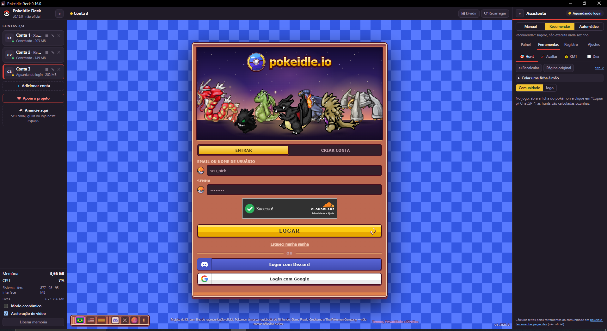
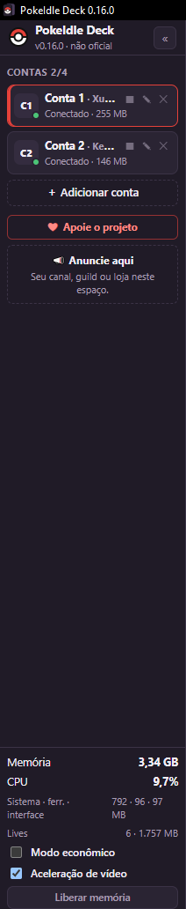
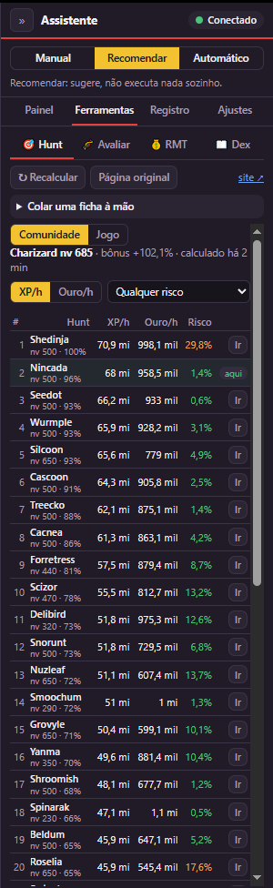
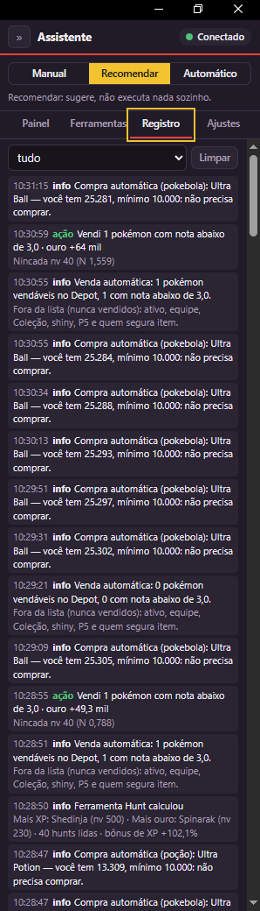

# PokeIdle Deck

**Jogue o PokeIdle com até 4 contas numa janela só — com um assistente que recomenda a melhor hunt,
abre as lives que dão bônus de XP e cuida da loja para você.**

### [⬇️ Baixar a versão mais recente](https://github.com/Xutezin/pokeidle-deck/releases/latest)

Na página que abrir, clique em <b>PokeIdleDeck-Setup-….exe</b>.

---

## ✨ O que ele faz

### 🎮 Várias contas, um app leve
- **Até 4 contas**, cada uma com o próprio login — troque com um clique ou **Ctrl+1…4**. As outras continuam
  jogando escondidas.
- **Tela dividida**: veja todas as contas ao mesmo tempo.
- Gasta bem menos memória que várias abas do navegador, com **modo econômico** para as contas em segundo plano.
- Login com **Google, Discord ou e-mail**, como no navegador. O app nunca vê a sua senha.

### 🧠 Assistente
- Recomenda a **melhor hunt** para o seu pokémon — por XP ou ouro, com **alerta de risco** e a 2ª melhor opção.
- Avisa quando o HP está baixo, leva ao Centro Pokémon e **volta a caçar** depois.
- Três modos: **Manual**, **Recomendar** (só sugere) ou **Automático** (executa só o que você liberar).
- **Esc** é a parada de emergência.

### 📺 Bônus das lives (Twitch e Kick)
- Abre sozinho as **lives oficiais** que estão no ar — escondidas, sem som e na menor qualidade — e fecha quando
  acabam. Na Twitch, dá até para pausar o vídeo (o bônus só olha o chat).
- Na Kick, fica nos canais com **mais pontos** e **resgata o bônus sozinho** (+15% XP, Capture Boost ou Secret Lure)
  quando o atual está acabando.

### 🛒 Loja no automático
- **Compra pokebolas e poções** quando faltam, com uma reserva de ouro que nunca é tocada.
- **Vende os pokémon de nota baixa** do Depot — nunca o ativo, a equipe, a Coleção, shiny ou P5.

### 📖 Ferramentas
- **Hunt**: XP, ouro e risco de cada hunt, com "Ir" para caçar lá.
- **Avaliar**: a nota oficial do jogo e os pontos fortes do pokémon.
- **Dex**: Pokédex com status, evolução, drops e onde cada um aparece.

### 🔄 Sempre atualizado
Quando sai versão nova, aparece **"⬆ disponível"** no app: um clique atualiza, sem perder contas nem ajustes.

&nbsp;

&nbsp;

 
Contas · Hunt (XP, ouro e risco de cada hunt) · Registro com a compra e a venda automáticas

---

## 📥 Como instalar

1. Baixe o **PokeIdleDeck-Setup-….exe** na [página de versões](https://github.com/Xutezin/pokeidle-deck/releases/latest).
2. Abra o arquivo e clique em **Instalar**. Não precisa de administrador.
3. Na primeira vez, um **tutorial** mostra a configuração inicial e todas as funções.

> **"O Windows protegeu o computador"?** O app ainda não tem assinatura digital paga, então o Windows avisa na
> primeira vez. Clique em **Mais informações → Executar assim mesmo**.

**Precisa de:** Windows 10 ou 11 (64 bits) e o Microsoft Edge WebView2, que já vem no Windows 11 e na maioria dos
Windows 10 — se faltar, o instalador mostra o link.

---

## 🔒 Segurança e privacidade

- O login é feito **na página do próprio jogo**. O app nunca vê nem guarda senha.
- Contas, logins e ajustes ficam **só no seu computador**.
- Toda atualização é **conferida** antes de instalar: se o arquivo não for o publicado aqui, ele é recusado.
- Baixe **só por este link**. Ao doar pelo Pix, o recebedor que aparece no banco é **LEONARDO VIEIRA DE MORAIS** —
  qualquer outro nome não é deste projeto.

---

## ❓ Perguntas frequentes

**Posso usar?** Os Termos do PokeIdle permitem automação dentro das mesmas regras de quem joga normalmente, e até
4 contas por pessoa. O app segue as duas coisas: nada de exploits e no máximo 4 contas.

**É oficial?** Não. É um projeto de fã, gratuito, sem ligação com o PokeIdle, a Nintendo, a Game Freak ou a The
Pokémon Company.

**É pago?** Não, e nada fica bloqueado. Se quiser apoiar, o botão **❤ Apoie o projeto** dentro do app tem um Pix.

**Achei um problema / tenho uma ideia.** Abra uma [issue](https://github.com/Xutezin/pokeidle-deck/issues) contando o
que aconteceu (um print ajuda muito).

---

Pokémon e todos os nomes relacionados são marcas de seus donos. Este projeto não é afiliado a eles.

