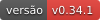
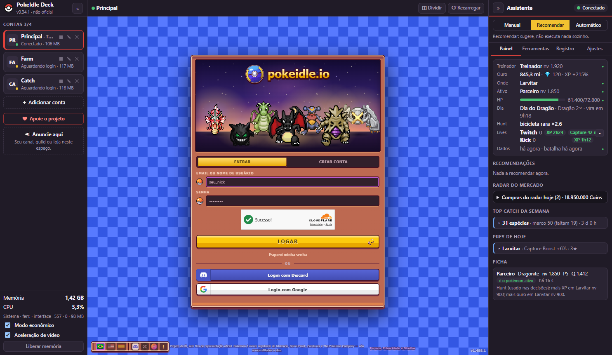
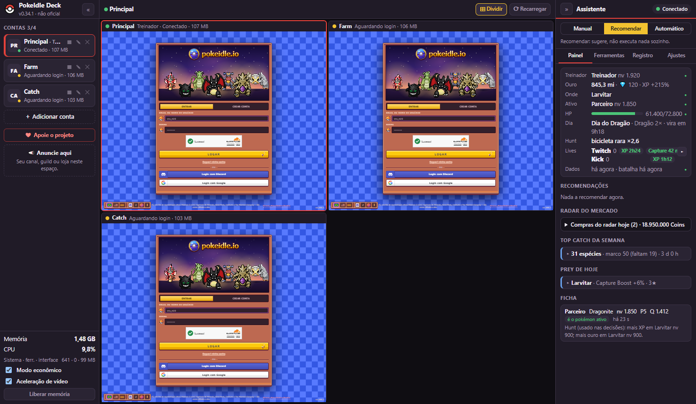
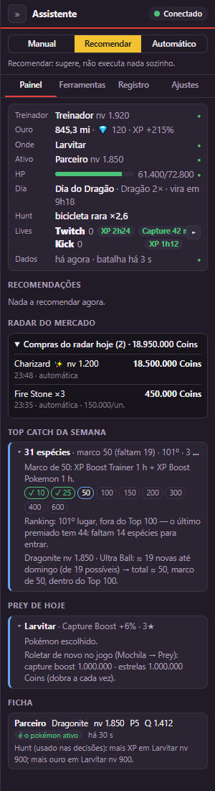
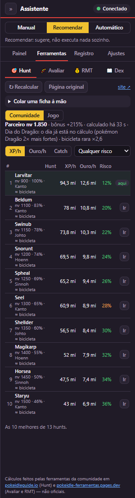
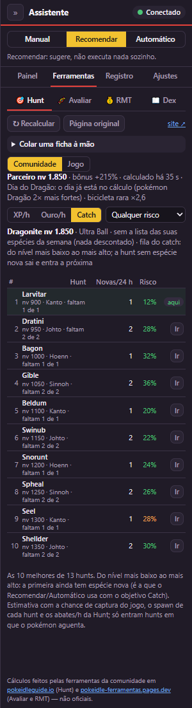
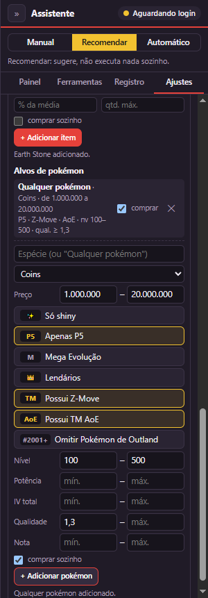
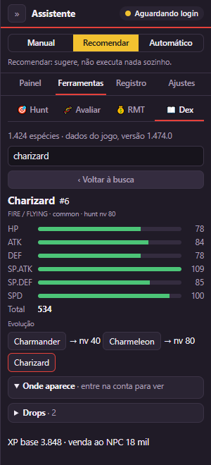

# PokeIdle Deck

**Jogue o PokeIdle com até 4 contas numa janela só — com um assistente que recomenda onde caçar, cuida das lives que
dão bônus, vigia o Mercado e faz as tarefas do dia por você.**

### [⬇️ Baixar a versão mais recente](https://github.com/Xutezin/pokeidle-deck/releases/latest)

Na página que abrir, clique em <b>PokeIdleDeck-Setup-….exe</b>.

Os valores que aparecem nas telas desta página são de exemplo.

---

## 🆕 Novidades recentes

| | |
|---|---|
| 🏆 **Top Catch da semana** | Espécies capturadas, próximo marco, sua posição no ranking e quantas dá para capturar até domingo |
| 🎯 **Hunt de catch** | Fila das hunts com espécie nova; o Automático pode seguir essa fila sozinho |
| 🎲 **Prey automático** | Faz a roleta grátis do dia e escolhe o pokémon — nunca gasta Coins |
| 🛰️ **Radar do Mercado** | Filtros iguais aos da loja do jogo, sorteio da liberação e histórico das compras |
| 🌧️ **Dia Sazonal** | A tipagem do dia entra na recomendação de hunt, junto com bicicleta e AoE |
| 💰 **Patrimônio** | Quanto a sua conta vale em Gemas |

A lista completa de cada versão está nas [Releases](https://github.com/Xutezin/pokeidle-deck/releases).

---

## 🎮 Várias contas, um app leve

- **Até 4 contas**, cada uma com o próprio login — troque com um clique ou **Ctrl+1…4**. As outras continuam
  jogando escondidas.
- **Tela dividida** para ver todas ao mesmo tempo.
- **Modo econômico** para gastar menos memória e CPU com as contas em segundo plano; o app mostra quanto cada uma usa.
- Pode ficar na **bandeja** (perto do relógio) e **abrir junto com o Windows**.
- Login com **Google, Discord ou e-mail**, como no navegador. O app nunca vê a sua senha.

---

## 🧠 Assistente

Três modos: **Manual**, **Recomendar** (só sugere) e **Automático** (executa só o que você liberar). A tecla **Esc**
é a parada de emergência.

- Recomenda a **melhor hunt** para o seu pokémon por **XP, ouro ou catch**, com alerta de risco.
- Avisa quando o HP está baixo, leva ao Centro Pokémon e **volta a caçar** depois.
- Mostra o **Dia Sazonal** e quando ele vira.
- **Coleta o Passe de Batalha** todo dia, para a sequência não zerar.
- **Volta sozinho** se a conta abrir em outro aparelho ou se o servidor do jogo cair.
- **Notificações** de drop e de shiny, com cada som ligado ou desligado separadamente.

### 🏆 Top Catch e Prey

- **Top Catch:** marcos da semana, prêmio do próximo, quando a semana fecha, sua posição no ranking e uma
  estimativa de quantas espécies novas o seu pokémon ainda consegue capturar.
- **Prey:** o app faz a roleta grátis do dia e escolhe um pokémon que aparece nas suas melhores hunts. As roletadas
  pagas e a compra da 2ª cartela **nunca** são feitas por ele.

 

---

## 🎯 Onde caçar

&nbsp;&nbsp;

 
As 10 melhores por XP ou ouro · Fila do catch

- XP, ouro e risco de cada hunt, com o botão **Ir** para caçar lá.
- O **tipo do dia**, o **AoE** e a **bicicleta** entram sozinhos na conta.
- **Catch:** da hunt de nível mais baixo à mais alta que o seu pokémon aguenta, mostrando as espécies que faltam.

---

## 📺 Bônus das lives (Twitch e Kick)

- Abre sozinho as **lives dos canais oficiais**, escondidas e sem som, e acompanha os pontos de cada canal.
- **Resgata o bônus** (XP, Capture Boost ou Secret Lure) quando o atual está acabando; o resto dos pontos fica
  guardado.
- As contas da Twitch e da Kick precisam estar vinculadas no jogo e logadas no app. Cada live aberta usa memória.

---

## 🛒 Loja e Mercado

- **Compra pokebolas e poções** quando faltam, com uma reserva de ouro que nunca é tocada.
- **Vende os pokémon de nota baixa** do Depot — nunca o ativo, a equipe, a Coleção, shiny ou P5.
- **Radar do Mercado:** escolha itens ou pokémon (P5, Z-Move, AoE, nível, qualidade, preço…) e ele avisa quando
  aparecer. Só **compra sozinho** os alvos que você marcar.
- Mostra se o pedido **entrou no sorteio**, quem levou e o **histórico de compras**.

 

---

## 📖 Ferramentas

- **Avaliar:** a nota oficial do jogo e os pontos fortes do pokémon.
- **Dex:** status, evolução, drops e onde cada um aparece.
- **RMT:** câmbio da Gema, conversor e o **patrimônio** da conta em Gemas.

Quando sai versão nova, aparece **"⬆ disponível"** no app: um clique atualiza, sem perder contas nem ajustes.

 

---

## 📥 Como instalar

1. Baixe o **PokeIdleDeck-Setup-….exe** na [página de versões](https://github.com/Xutezin/pokeidle-deck/releases/latest).
2. Abra o arquivo e clique em **Instalar**. Não precisa de administrador.
3. Na primeira vez, um **tutorial** mostra a configuração inicial e todas as funções.

> **"O Windows protegeu o computador"?** O app ainda não tem assinatura digital paga, então o Windows avisa na
> primeira vez. Clique em **Mais informações → Executar assim mesmo**.

**Precisa de:** Windows 10 ou 11 (64 bits) e o Microsoft Edge WebView2, que já vem no Windows 11 e na maioria dos
Windows 10 — se faltar, o instalador mostra o link.

---

## 🔒 Segurança e privacidade

- O login é feito **na página do próprio jogo**. O app nunca vê nem guarda senha.
- Contas, logins e ajustes ficam **só no seu computador**.
- Gastar Coins ou Gemas depende sempre de uma opção que **você** liga.
- Toda atualização é **conferida** antes de instalar: se o arquivo não for o publicado aqui, ele é recusado.
- Baixe **só por este link**. Ao doar pelo Pix, o recebedor que aparece no banco é **LEONARDO VIEIRA DE MORAIS** —
  qualquer outro nome não é deste projeto.

---

## ❓ Perguntas frequentes

**Posso usar?** Os Termos do PokeIdle permitem automação dentro das mesmas regras de quem joga normalmente, e até
4 contas por pessoa. O app segue as duas coisas: nada de exploits e no máximo 4 contas.

**É oficial?** Não. É um projeto de fã, gratuito, sem ligação com o PokeIdle, a Nintendo, a Game Freak ou a The
Pokémon Company.

**É pago?** Não, e nada fica bloqueado. Se quiser apoiar, o botão **❤ Apoie o projeto** dentro do app tem um Pix.

**Achei um problema / tenho uma ideia.** Abra uma [issue](https://github.com/Xutezin/pokeidle-deck/issues) contando o
que aconteceu (um print ajuda muito).

---

Pokémon e todos os nomes relacionados são marcas de seus donos. Este projeto não é afiliado a eles.

